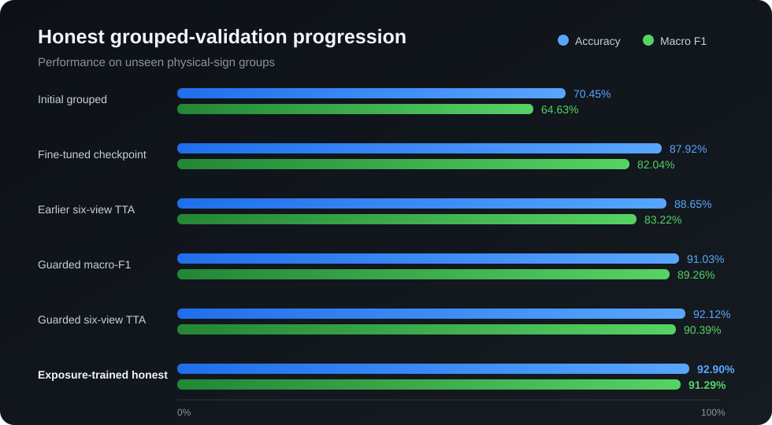
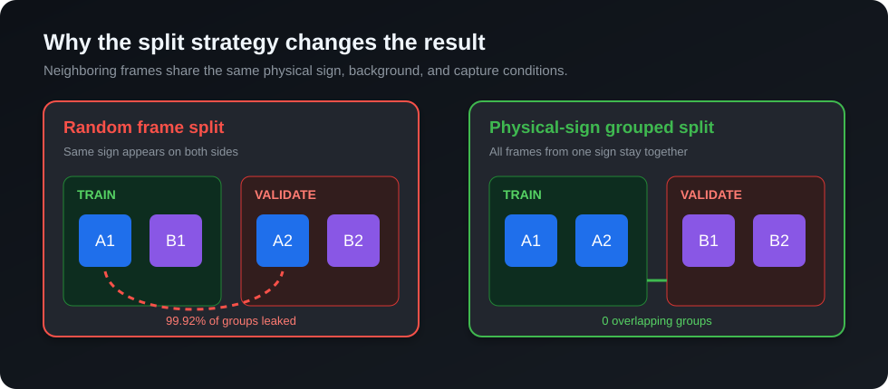
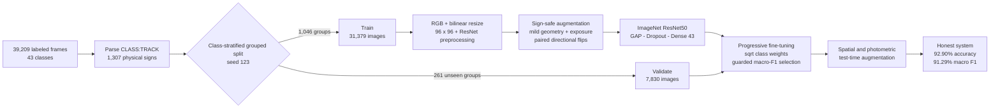

# Leakage-Aware Traffic Sign Recognition with ResNet50

[](https://github.com/danieltalbert/traffic-sign-resnet50/actions/workflows/tests.yml)


A reproducible TensorFlow computer-vision pipeline for classifying 43 traffic-sign classes. The most important result was not a new layer—it was repairing the evaluation. A random frame split had leaked almost every physical sign across training and validation, so I rebuilt the project around class-stratified physical-sign groups and optimized against honest grouped macro F1.

## Results at a glance

| Evaluation | Accuracy | Macro F1 |
|---|---:|---:|
| Initial corrected grouped model | 70.45% | 64.63% |
| Fine-tuned single checkpoint | 87.92% | 82.04% |
| Earlier six-view TTA | 88.65% | 83.22% |
| Guarded macro-F1 checkpoint | 91.03% | 89.26% |
| Six-view guarded-model TTA | 92.12% | 90.39% |
| **Exposure-trained honest system** | **92.90%** | **91.29%** |

The final honest result was measured on **7,830 images from 261 unseen physical-sign groups**. Relative to the initial leakage-free model, grouped accuracy improved by **22.45 percentage points** and macro F1 by **26.66 points**.



## The hidden leakage problem

Each physical road sign appears in a short sequence of neighboring camera frames. Splitting individual images at random placed **1,306 of 1,307 sign groups in both partitions (99.92% overlap)**. Every image in the old validation partition belonged to a sign already represented in training.

The corrected split parses each image as `CLASS:TRACK`, stratifies groups inside each class, and assigns each physical sign wholly to one partition:

- Training: 31,379 images from 1,046 groups
- Validation: 7,830 images from 261 groups
- Group overlap: **0**



## Modeling pipeline



Key engineering decisions:

- A single shared module owns class IDs, image ordering, grouped splitting, RGB conversion, resizing, and ResNet preprocessing.
- Horizontal flips are permitted only for four known directional class pairs, with the label remapped at the same time.
- Square-root inverse-frequency weights improve rare classes without the instability of full inverse-frequency weighting.
- Fine-tuning checkpoint selection maximizes exact 43-class macro F1 while rejecting large accuracy regressions.
- Deterministic seeds, split manifests, shape assertions, and submission validation prevent silent training/inference drift.

## Calibration experiment

A separate research experiment fit one global 43-class log-score bias to a labeled 201-image reference and reached **200/201 (99.50%)** on that same reference. Because the bias was fitted to those labels, this is an **in-sample calibration result—not an estimate of unseen-data performance or the full-holdout score**. The calibrated system also scored below the honest system on grouped validation (91.63% accuracy, 89.91% macro F1).

The honest 92.90% / 91.29% grouped result is therefore the headline result for this project. See the [model card](docs/MODEL_CARD.md) for evaluation boundaries and limitations.

## Repository map

```text
.
|-- roadsign_pipeline.py          # Shared data and leakage-prevention rules
|-- resnet_roadsigns.py           # ResNet50 training and fine-tuning
|-- predict_holdout.py            # Deterministic inference and CSV validation
|-- predict_tta_holdout.py        # Multi-view test-time augmentation
|-- evaluate_*.py                 # Grouped, ensemble, and photometric studies
|-- audit_roadsigns.py            # End-to-end data/model contract audit
|-- test_*.py                     # 19 focused unit tests
|-- results/                      # Compact, aggregate experiment metrics
|-- docs/                         # Model card and publication-safe visuals
`-- .github/workflows/tests.yml   # Reproducible CPU test workflow
```

Model checkpoints, raw images, course answer files, probability caches, and submission files are intentionally excluded. The local experimental workspace remains intact, while the repository stays small and safe to clone.

## Quick start

```bash
python3.12 -m venv .venv
source .venv/bin/activate
python -m pip install --upgrade pip
python -m pip install -r requirements.txt
python -m unittest -v \
  test_roadsign_pipeline.py \
  test_resnet_training_tools.py \
  test_mini_calibrated_submission.py
```

Inspect the available training controls:

```bash
python resnet_roadsigns.py --help
```

The project includes a WSL/Linux launcher that discovers `.venv`, Conda, or system Python and assembles NVIDIA wheel library paths when available:

```bash
./run_tensorflow.sh -m unittest -v test_roadsign_pipeline.py
```

Training requires the separately obtained dataset and a TensorFlow-compatible GPU. A typical leakage-free run starts with:

```bash
./run_tensorflow.sh resnet_roadsigns.py \
  --data-dir data/roadsigns \
  --img-size 96 \
  --deterministic-data \
  --class-weight-power 0.5 \
  --paired-hflip-prob 0.5 \
  --photometric-aug-prob 0.5
```

## Verification

The publication snapshot was checked with:

- 19/19 unit tests passing
- 39,209 training images and all 43 class folders detected
- 1,307 physical-sign groups detected
- Zero overlap between training and validation groups
- 12,630 holdout filenames contiguous from `00000.jpg` through `12629.jpg`
- Model contract verified as `(None, 96, 96, 3) -> (None, 43)`
- All CLI entry points returning successfully for `--help`
- No broken packages in the pinned environment

## Data and artifact policy

This repository contains original project code and aggregate evaluation results only. It does **not** redistribute the BYU-Idaho course dataset, GTSRB-style image files, holdout images, reference answers, trained checkpoints, or full prediction exports. Obtain any dataset from its authorized source and follow its terms and your institution's academic-integrity policy.

Project code is licensed under the [MIT License](LICENSE). Dataset and course materials are not covered by that license.
